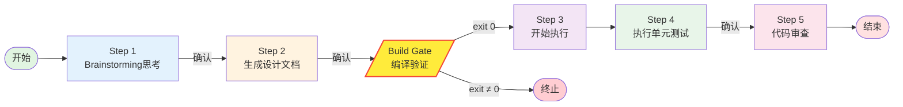

# HELM Auto

## Overview

`helm:auto` 为带人工闸门的分步开发编排入口。以 `.openspec/changes/<name>/helm-auto-memory.md` 追踪进度；每步完成后更新 memory，**未经人类确认不得进入下一步**。

explore / propose / apply / 单元测试一律走 **HELM canonical skill**，不直接调用底层 OpenSpec 命令。

## When to Use

- 从需求探索到设计、实现、单测、审查需要分步推进且每步需人工确认
- 希望用统一 memory 文件追踪 auto 流程进度

## When NOT to Use

- artifacts 已齐全且仅需单次 `helm-workflow-apply`
- 用户要求跳过人工闸门全自动推进

## Process

### 启动前

> **前置加载（HARD-GATE）**：MUST 用 Skill 工具实际加载 frontmatter `requires_skills` 的全部项（声明 ≠ 加载）；
> MUST 在本阶段日志写入 `### Skills Loaded` 证据段，声明了但未列出的依赖判为未加载；
> 任一项加载失败 → 立即停止，不得降级继续。
> 路径基准：仓库根相对路径（见 `references/skill-loading-contract.md` 第 0 节）。
> 完整规则见 `references/skill-loading-contract.md`。
   后续 Step 1.1 / 1.2 / 1.3 / 2.1 / 3.1 / 3.2 等再次"加载"语句视为对子流程的提示，已加载者无需重复调用 Skill 工具；但**首次进入对应 Step 前**必须确认本步骤所需 skill 已在上述 `Skills Loaded` 列表中。
1. 通过 git 取得当前用户名（用于 `<name>` 命名）
2. `wiki_id` 不清楚时询问人类伙伴
3. **Change 命名**：`<name>` 仅小写字母与横杠，格式 `wiki-{wiki_id}-{业务名}-{用户名}`；用户名中的 `.` 转为 `-`
4. 若不确认 `<name>` 或 change 不存在，询问人类伙伴或给出建议 `<name>`
5. 读取 `.openspec/changes/<name>/helm-auto-memory.md` 确认当前进度；不存在则按模板创建

### 流程图




### 约束

- **不要自行进入下一阶段**；每步末尾必须用询问模板征求人类确认（Build Gate 除外，自动执行）
- 事实源：`.openspec/changes/<name>/` 下 artifacts；冲突时先 `helm-workflow-reverse-sync`

### 询问模板

```text
是否进行下一步 Step N: <下一步标题>
0. 不进行下一步，我有信息补充
1. 进行下一步
```

### helm-auto-memory.md 标准

进度文件写入 `<change>/helm-auto-memory.md`（workbench 模式下为 `<root>/features/<年>/<年月>/<slug>/helm-auto-memory.md`）。
格式**唯一真源**为 `templates/helm-auto-memory.md`，本文件 MUST NOT 内联另一套格式。
每完成一步，把对应行 `[ ]` 改为 `[x]`；新增需求在文件末尾追加新的日期小节。

---

### Step 1: 使用 brainstorming skill 进行思考

1.1 加载 `superpowers:brainstorming`，获取苏格拉底式发散思维方法。

1.2 加载 `superpowers:test-driven-development`，获取 TDD 开发流程。

1.3 加载 `helm-workflow-explore`，按 explore 流程调查代码库；可配合 `openspec list --json` 确认 OpenSpec 上下文。

1.4 结合 brainstorming 的发散思维与 explore 的调查能力，帮助人类伙伴探索问题空间；优先可视化思考（ASCII 图表达架构与数据流）。

1.5 需求与探索收敛后，将总结写入 `.openspec/changes/<name>/learnings.md`。

1.6 更新`.openspec/changes/<name>/helm-auto-memory.md`（勾选 Step 1），如果是需求变动或新增需求，追加新的需求功能点记忆。

1.7 使用询问模板确认是否进入 Step 2。

---

### Step 2: 执行生成详细设计文档

2.1 加载 `helm-workflow-propose`，按 propose 流程生成 artifacts：`proposal` → `specs` → `design` → `tasks`。

2.2 `tasks.md` 必须拆分到代码方法级别，并按 TDD 拆为 RED / GREEN / REFACTOR 三阶段。

**tasks.md 质量标准：**

- 每个 task 标注是否支持多 Agent；无依赖的 task 可多 Agent 执行
- 每个 task 标注复杂度：🟢简单 / 🟡中等 / 🔴复杂
- 每个 task 包含明确验收标准
- 标注 task 间依赖关系
- 包含对应测试 task
- 粒度：每个 task 可在单次 agent 调用中完成
- 所有 `🟡` / `🔴` task 验收标准必须显式包含 TDD 项：失败测试场景/命令、通过测试场景/命令
- `🟡` / `🔴` task 若无法形成最小测试闭环，须继续拆分至有测试切入点
- **禁止**在 task 中写「不包含 TDD」「跳过 TDD」「无需测试」「review 替代 TDD」「编译太慢跳过 TDD」等豁免语句

**tasks.md 模板示例：**

```markdown
地址拆分功能改进
是否支持多Agent: 是
- [ ] 🟢简单【RED阶段】地址拆分功能改进
- [ ] 🟢简单【GREEN阶段】地址拆分功能改进
- [ ] 🟢简单【REFACTOR】地址拆分功能改进
```

2.3 检查 `design.md` 与 `tasks.md` 是否符合设计；请人类伙伴确认后更新 `helm-auto-memory.md`（勾选 Step 2）。

2.4 使用询问模板确认是否进入 Build Gate。

---

### Build Gate: 编译验证

**apply 启动之前必须执行编译验证。**

1. 构建门禁**完全沿用** `helm-workflow-apply` 的「S6.5 构建硬门」，本文件不重复定义。差异仅一处：auto 在每一步结束后额外要求把最后 5–10 行输出（含 `exit code: 0`）粘贴进 log，以便人工在长流程中断后快速确认。
2. 执行构建
3. exit code = 0 → 进入 Step 3
4. exit code ≠ 0 → 向人类伙伴展示错误输出，使用询问模板：

```text
Build Gate 构建失败。错误摘要见上。
0. 终止 apply（默认），修复构建环境/代码后重跑
1. 环境限制导致 CLI 构建无法执行，已通过构建工具验证编译通过（需粘贴构建成功标志 + exit code 0 的最后 5-10 行输出作为证据，记录到 log.md）
2. 自动分析错误并生成修复 → 重跑 Build Gate（最多 3 轮）
```

   - 选 0 → 终止 auto 流程
   - 选 1 → 要求人类伙伴粘贴构建输出的最后 5-10 行（须含构建成功标志及 `exit code 0`），记录到 `log.md` 作为证据后方可进入 Step 3。无有效证据 → 拒绝旁路
   - 选 2 → 提取构建输出中的 `ERROR` 行，按文件名+行号定位源码，生成修复（不新增功能），修复后立即重跑 Build Gate。每轮修复结果追加到 `log.md`。3 轮后仍失败 → 降级为选项 0/1 询问

---

### Step 3: 开始执行

**前置条件：Build Gate exit code = 0，或人工确认 bypass 已记录到 log.md。**

3.1 加载 `superpowers:test-driven-development`。

3.2 加载 `helm-workflow-apply`，按 apply 流程串行执行 tasks（implementer → review → 回写 → 最小验证 → commit）。apply 的构建门禁作为二次兜底。

3.3 更新 `helm-auto-memory.md`（勾选 Step 3）。

3.4 使用询问模板确认是否进入 Step 4。

---

### Step 4: 执行单元测试

4.1 用 `git diff` 分析本次新增的单元测试。

4.2 **测试存活校验（MUST）**：每个新增测试文件确认：
   - 被至少一个页面/入口文件 `import` 并调用（可在编辑器中点击跳转验证）
   - 无标红/报错（import 路径可解析，方法签名匹配）
   - 未被引用的测试文件视为死代码，禁止提交

4.3 按项目类型构建并执行测试。

按仓内标准入口执行，不写死工具链：

```bash
# 单测命令来自仓内配置，例如：
# <test_cmd> <测试类>[.<方法名>]
```

- 命令优先级：仓内配置文件声明的 `test_command` → 标准入口（`make test`、`npm test`、`go test ./...`、`pytest`、`cargo test` 等）→ 询问用户。
- 运行前确认所需运行时版本；版本不符时停止并报告，不擅自切换。

4.4 确保本次相关单元测试全部通过，输出测试报告。

4.5 请人类伙伴确认后更新 `helm-auto-memory.md`（勾选 Step 4）。

4.6 使用询问模板确认是否进入 Step 5。

---

### Step 5: 代码审查

5.1 检查项目内是否存在规则文件（Windows 下可用 Bash `ls` 列出目录）。按当前宿主检查对应 `rules/` 目录，例如：

- Cursor：`<AGENT_DIR>/rules/*.mdc`
- CodeBuddy / Claude：`<AGENT_DIR>/rules/*.md` 或 `*.mdc`
- 亦检查项目根下 `codebuddy/rules/` 等镜像路径（若存在）

5.2 若未找到规则文件，告知人类并**终止流程**。

5.3 用 `git diff` 分析本次变更。

5.4 向人类确认是否需要执行单元测试：

- 若允许 → 回到 Step 4 执行
- 否则 → 进行规范检查（可加载 `helm-workflow-review-implementation`）

5.5 审查通过且单元测试通过后：

- 更新 `helm-auto-memory.md`（勾选 Step 5，全部完成）
- 总结本次实现的经验与踩坑，可追加到 `learnings.md`
- 提示人类伙伴项目已完成，给出审查报告

## Verification

- [ ] 已读取或创建 `helm-auto-memory.md` 并按步更新
- [ ] 每步末尾已向人类确认，未擅自跳步（Build Gate 除外）
- [ ] Build Gate 已执行且 exit code 0 记录在 log.md
- [ ] explore / propose / apply 使用 HELM canonical skill
- [ ] Step 4 单测有执行证据；Step 5 规则文件检查已执行

## Red flags

- 未经确认进入下一阶段
- Build Gate 未通过仍进入 Step 3
- 用 OpenSpec 旧式 slash 编排（见「历史命令对照」表左列）替代本流程规定的 `helm-workflow-*` skill
- 使用 `memory.md` 而非 `helm-auto-memory.md`
- Build Gate 失败后仍提交 commit
- Step 5 无规则文件仍继续审查
- tasks 中出现 TDD 豁免语句
- commit 前缺少 per-task build exit code 0 证据（apply S6.5）
